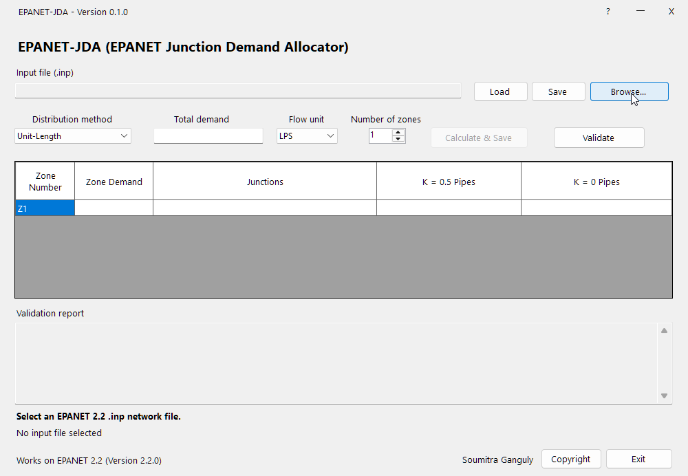
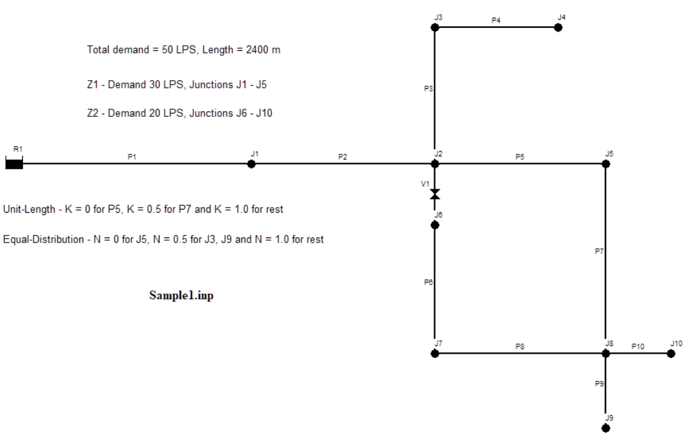
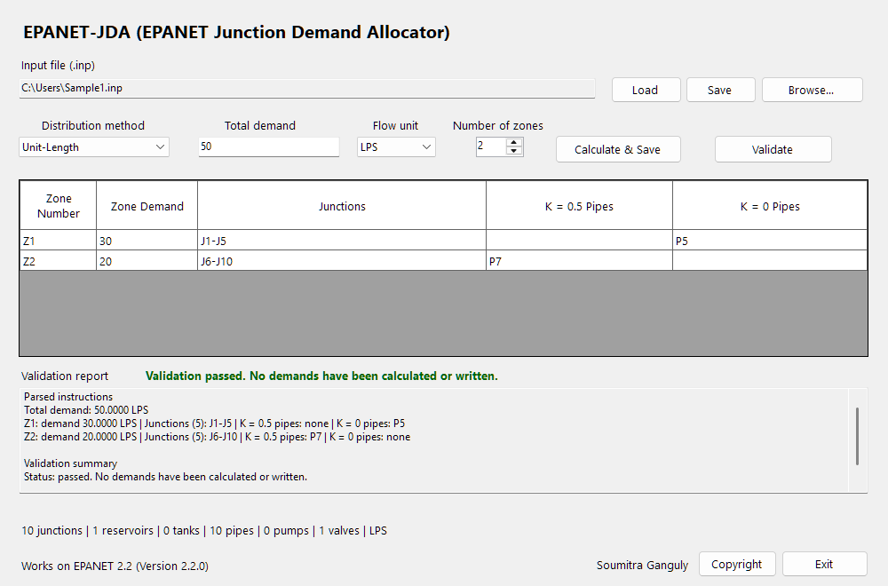
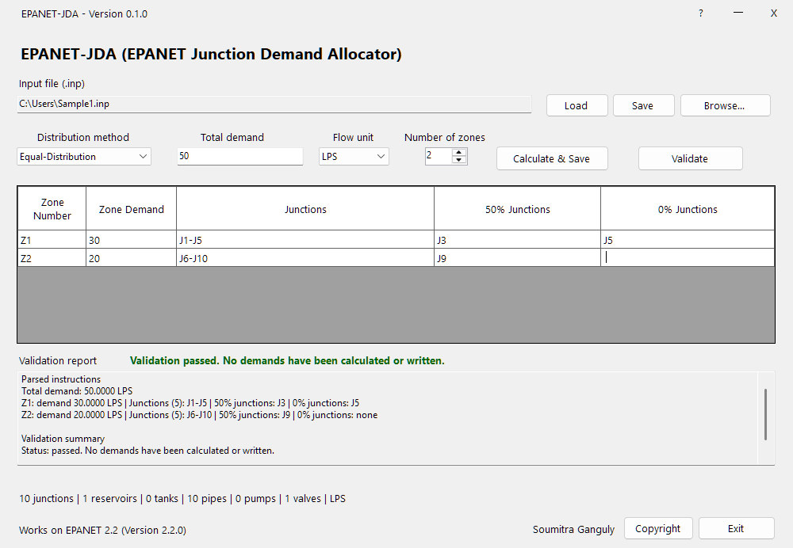

## EPANET-JDA (EPANET Junction Demand Allocator)

## User Guide & Technical Reference Manual — Version 0.1.0 {#manual-subtitle}

### 1. Overview and Capabilities
EPANET-JDA is a Windows-based utility which calculates junction base demands of an EPANET 2.2 hydraulic network model. It supports two standard demand allocation methodologies: **Unit-Length** and **Equal-Distribution** (refer later sections for detail). The application operates strictly as a pre-processor; it does not execute EPANET hydraulic simulations and does not require the EPANET simulation engine installed on the host machine.

The program reads a user-supplied input (.inp) file of EPANET 2.2, computes junction demands according to user-defined zones and weighting parameters, and writes a separate, verified input (.inp) file. Existing junction base demands in the **[JUNCTIONS]** section are replaced with the calculated values. Any active records in the **[DEMANDS]** section are removed to eliminate double-counting. Associated demand pattern assignments, operational controls, curves, and link parameters remain untouched. The source file is never overwritten or altered.

### 2. System Requirements and Installation

**Operating System:** Windows 10 or Windows 11.
**Runtime:** Standalone desktop executable (no external installer or runtime setup wizard required).
**Package Archive (epanetjda.zip):** Contains epanetjda.exe, EPANET_JDA.pdf, and one EPANET 2.2 sample input (.inp) file. 
Extract the entire archive to any local directory.

### 3. Typical Workflow

3.1 **Export Network File:** In EPANET 2.2, open or verify your network. Navigate to **File** &gt; **Export** &gt; **Network...** and export a clean input (.inp) file.

3.2 **Determine Demand Boundaries:**
For **Unit-Length**, compile total zone demands, zone junction lists, and pipe IDs where K ≠ 1.0.
For **Equal-Distribution**, compile total zone demands, zone junction lists, and junction IDs where N ≠ 1.0.  
  
3.3 **Launch the Program:** Open epanetjda.exe. The initial workspace appears as shown in **Figure 1**.

3.4 **Load .inp file:** Click **Browse...** to select your .inp file. Check the status panel to verify junction counts, link counts, and network flow units.

3.5 **Select Method:** Choose **Unit-Length** or **Equal-Distribution** from the method drop-down list.

3.6 **Set Demand &amp; Units:** Enter the total network demand and confirm that the selected flow unit strictly matches the unit configured in the source file's **[OPTIONS]** section.

Ensure that, when the Browse... button is highlighted (receives focus), a help message is displayed.

3.7 **Define Zones:** Enter the number of zones; matching rows will automatically populate in the Zone Detail grid.

3.8 **Populate Zone Data:** Provide unique zone names, target zone demands, and assigned Junction IDs (using comma-separated values and/or numeric ranges like J1-J5, J7, J9).

3.9 **Assign Modifiers:**

3.9.1 Under **Unit-Length**, enter pipe IDs requiring K = 0.5 or K = 0.0.

3.9.2 Under **Equal-Distribution**, enter junction IDs requiring N = 0.5 or N = 0.0.

3.10 **Validate Inputs:** Click **Validate**. Correct any reported errors in the validation pane. Validation verifies network topology and demand balances without modifying files.

3.11 **Calculate &amp; Save:** Click **Calculate &amp; Save**. The program computes allocations, generates a new .inp file, and also saves an analysis report (.txt) in the same folder as the source file. The output filename appears in the window; make a note of it.

3.12 **File Versioning:** Generated files are automatically saved with the original name plus name of the method used adding sequential tags (e.g., Sample1_UnitLength_1.inp or Sample1_EqualDistribution_1.inp). Existing input files are never overwritten.

3.13 **Session State (Optional):** Click **Save** to export current workspace settings to a .dgsession.json session file. Click **Load** to restore an earlier session.

3.14 **Hydraulic Simulation:** Open the resulting .txt to inspect base demands. Finally, import the .inp file into EPANET 2.2, verify base demands, and run network simulations.

The application does not run a hydraulic simulation.

The complete build and run instructions are also available in the project README file. 

### 4. Input Rules and Validation Constraints

### 4.1 Network Total and Flow Units

Network total demand must be a finite, positive number.
Supported EPANET flow units: CFS, GPM, MGD, IMGD, AFD, LPS, LPM, MLD, CMH, and CMD.
The selected unit must match the unit declared in the network's **[OPTIONS]** section.
The sum of all zone demands must reconcile with the network total demand within a tolerance of 0.1%. Discrepancies exceeding 0.1% are flagged as fatal validation errors; minor rounding variances trigger informational warnings.

### 4.2 Demand Pattern and Section Handling

**[JUNCTIONS]** Section: The base demand column (Column 3) of the .inp file is updated with calculated values. If an existing junction entry references a Demand Pattern ID (Column 4), that pattern association remains preserved.
**[DEMANDS]** Section: Any secondary or extended demand records are removed to prevent duplicating consumer baseline drafts.
Original .inp: The original .inp file remains completely untouched.

### 4.3 Zone and Element Constraints

Zone identifiers must begin with an alphabetic character, may contain alphanumeric characters, hyphens, or underscores, and must not exceed 31 characters.
Every junction in the network must be assigned. Unassigned junctions or duplicate junction assignments between zones will trigger validation failures.
Reservoirs and tanks shares no demand and cannot be assigned to zones.
Non-pipe link elements (pumps, PRVs, PSVs, PBVs, FCVs, TCVs) possess no physical pipeline length and are omitted from Unit-Length weighting calculations.

### 5. Method-specific modifier columns

The last two grid columns have different meanings depending on the selected method.

| Method | Column 1 modifier | Column 2 modifier | Default (Unlisted) |
| :---: | --- | --- | --- |
| **Unit-Length** | Pipe IDs with K = 0.5 | Pipe IDs with K = 0 | K = 1.0 (Full weight) |
| **Equal-Distribution** | Junction IDs with N = 0.5 (50%) | Junction IDs with N = 0.0 (0%) | N = 1.0 (100% weight) |

For **Unit-Length**, unlisted pipes use K = 1. A pipe modifier must be entered under a zone that contains at least one endpoint of that pipe. A pipe can have only one K assignment. If a pipe belongs to two zones, its ID can be entered in either zone, but not both.

Every positive-demand Unit-Length zone must have positive K-weighted pipe length contributing to its junctions. A pipe with K = 0 contributes no weight to either endpoint.

For **Equal-Distribution**, unlisted junctions use 100% weight. A positive-demand zone must retain at least one junction with positive weight; it cannot assign 0% weight to every junction.

A valve or pump is a link without a pipe length and is not used by Unit-Length length weighting. For example, the valve `V1` in the sample network connects `J2` and `J6`; it has no length contribution. `J6` remains a normal junction assigned to Z2.

### 6. Calculation methods

### 6.1 Unit-Length

**Unit-Length** distributes each zone's entered demand according to K-weighted pipe-length contributions to its junctions. Known or metered junction demands are not used.

For each pipe `p`:

$$
L_{p,\mathrm{eff}} = K_p L_p
$$

For a junction endpoint `j` of pipe `p`, the pipe contribution is:

$$
w_{j,p} = \frac{K_p L_p}{n_J(p)}
$$

where `n_J(p)` is the number of junction endpoints. It is 2 for a junction-to-junction pipe and 1 when the other endpoint is a reservoir or tank. The junction weight is the sum of the contributions from all incident pipes:

$$
w_j = \sum_{p \text{ incident to } j} w_{j,p}
$$

A pipe connected to a reservoir or tank contributes its full effective length to the junction endpoint. A pipe between two junctions contributes half of its effective length to each endpoint. For zone `z`, the zone weight and junction demand are:

$$
W_z = \sum_{j \in J_z} w_j, \qquad
D_j = D_z \frac{w_j}{W_z}
$$

A positive-demand zone must have `W_z > 0`. The application adjusts floating-point rounding at one junction so the calculated demands sum to the entered zone demand.

### 6.2 Equal-Distribution

**Equal-Distribution** does not use pipe lengths, K factors, or known or metered junction demands. Junction weights are 1.0 for unlisted junctions, 0.5 for junctions listed at 50%, and 0 for junctions listed at 0%.

For each junction `j`, let `a_j` be its allocation weight. For zone `z`:

$$
A_z = \sum_{j \in J_z} a_j, \qquad
D_j = D_z \frac{a_j}{A_z}
$$

Calculated demands within each zone sum to the entered zone demand. A zero-demand zone can have zero weights throughout.

### 7. Worked example: sample network

The package includes `Sample1.inp`. It contains 10 junctions (`J1` through `J10`), one reservoir (`R1`), one valve (`V1` connecting J2 to J6), 10 pipes, and the flow unit `LPS` with total network demand defined at 50 LPS.

The valve connects `J2` to `J6`. It has no pipe length and does not contribute to Unit-Length weighting. The valve is a separate link and must not be entered as a pipe modifier.

The system is evaluated under a two-zone configuration:
**Unit-Length:**

| Zone | Demand | Junctions | Pipe K Inputs |
| :---: | :---: | :---: | :---: |
| Z1 | 30 LPS | J1-J5 | K = 0 for P5 | 
| Z2 | 20 LPS | J6-J10 | K = 0.5 for P7 |

**Equal-Distribution:**

| Zone | Demand | Junctions | Junction N Inputs |
| :---: | :---: | :---: | :---: |
| Z1 | 30 LPS | J1-J5 | N = 0.5 for J3 and N = 0 for J5 | 
| Z2 | 20 LPS | J6-J10 | N = 0.5 for J9 |

The two zones cover all 10 junctions exactly once. `J6` is a junction in Z2, not a valve or pipe node.

### 7.1 Unit-Length example

Set  demand allocation for Z1 to 30 LPS and for Z2 to 20 LPS. 
For Z1, set `P5` to K = 0. All other pipes use K = 1 by default. 
For Z2, set `P7` to K = 0.5. All other pipes use K = 1 by default. 
A pipe connected to a reservoir or tank contributes its full effective length to its junction endpoint. A pipe between two junctions contributes half of its effective length to each endpoint.

| Zone | Junction | Weight | Allocation Ratio | Demand (LPS) | Notes |
| :---: | :---: | :---: | ---: | ---: | :--- |
| Z1 | J1 | 550.0 | 550.0/1177.5 | 14.0127 | P1 (400 m), P2 (150 m) |
| Z1 | J2 | 265.0 | 265.0/1177.5 | 6.7516 | P2 (150 m), P3 (115 m), V1 (0 m) |
| Z1 | J3 | 200.0 | 200.0/1177.5 | 5.0955 | P3 (115 m), P4 (85 m) |
| Z1 | J4 | 85.0 | 85.0/1177.5 | 2.1656 | P4 (85 m), P5 (0 m, K=0) |
| Z1 | J5 | 77.5 | 77.5/1177.5 | 1.9745 | P5 (0 m), P7 (77.5 m, K=0.5) |
| Z1 Total | -- | 1177.5 | -- | 30.0 | Zonal demand matched |
| Z2 | J6 | 155.0 | 155.0/817.5 | 3.7920 | V1 (0 m), P6 (155 m) |
| Z2 | J7 | 280.0 | 280.0/817.5 | 6.8502 | P6 (155 m), P8 (125 m) |
| Z2 | J8 | 292.5 | 292.5/817.5 | 7.1560 | P7 (77.5 m), P8 (125 m), P9 (50 m), P10 (40 m) |
| Z2 | J9 | 50.0 | 50.0/817.5 | 1.2232 | P9 (50 m, dead-end branch) |
| Z2 | J10 | 40.0 | 40.0/817.5 | 0.9786 | P10 (40 m, dead-end branch) |
| Z2 Total | -- | 817.5 | -- | 20.0 | Zonal demand matched |
| Network | -- | 1995.0 | -- | 50.0 | Total demand matched |

The total Unit-Length weight is 1,177.5 m for Z1 and 817.5 m for Z2. The values are rounded to four decimal places, while the application calculates with full precision.

For example, `P1` contributes 400 to J1 because it connects the reservoir `R1` to J1. `P2` contributes 150 to both J1 and J2. `P7` contributes 77.5 to J5 and J8 because its effective length is 155 × 0.5. `P5` contributes nothing because its K factor is 0.

### 7.2 Equal-Distribution example

Set  demand allocation for Z1 to 30 LPS and for Z2 to 20 LPS.  
For Z1, set `J3` to N = 0.5 (50%) and `J5` to N = 0 (0%). All other junctions use N = 1 by default. The resulting Z1 total weight is 3.5.
For Z2, set `J9` to N = 0.5 (50%). All other junctions use N = 1 by default. The resulting Z2 total weight is 4.5.

| Zone | Junction | Weight | Allocation Ratio | Allocated demand (LPS) | Notes |
| :---: | :---: | :---: | ---: | ---: | :---: |
| Z1 | J1 | 1.0 | 1.0 / 3.5 | 8.5714 | Standard junction |
| Z1 | J2 | 1.0 | 1.0 / 3.5 | 8.5714 | Standard junction |
| Z1 | J3 | 0.5 | 0.5 / 3.5 | 4.2857 | 50% modifier applied |
| Z1 | J4 | 1.0 | 1.0 / 3.5 | 8.5714 |Standard junction |
| Z1 | J5 | 0.0 | 0.0 / 3.5 | 0.0000 | 0% modifier applied |
| Z1 Total | -- | 3.5 | -- | 30.0 | Zonal demand matched |
| Z2 | J6 | 1.0 | 1.0 / 4.5 | 4.4444 | Standard junction |
| Z2 | J7 | 1.0 | 1.0 / 4.5 | 4.4444 | Standard junction |
| Z2 | J8 | 1.0 | 1.0 / 4.5 | 4.4444 | Standard junction |
| Z2 | J9 | 0.5 | 0.5 / 4.5 | 2.2222 | 50% modifier applied |
| Z2 | J10 | 1.0 | 1.0 / 4.5 | 4.4444 | Standard junction |
| Z2 Total | -- | 4.5 | -- | 20.0 | Zonal demand matched |
| Network | -- | 8.0 | -- | 50.0 | Network demand matched |

### 8. Reviewing generated files

The detailed `.txt` report lists the network summary, entered instructions, calculated junction demands and weights, warnings, and entered-versus-allocated totals. Check that the zone and network totals match the intended values.

The generated .inp file contains the new junction base demands. Active **[DEMANDS]** records from the source are removed to prevent double counting. The source .inp is not modified.

If generation fails, read the validation or error text in the application, correct the source or entered values, validate again, and generate a new copy. Existing generated files and reports are preserved; a new sequence number is used rather than overwriting them.

### 9. License
EPANET-JDA is open-source software licensed under the GNU General Public License v3.0 (GPLv3).

### 10. Disclaimer
EPANET-JDA is provided "as is", without warranty of any kind, express or implied, including but not limited to the warranties of merchantability, fitness for a particular purpose, and non-infringement. In no event shall the authors, copyright holders, or contributors be held liable for any claim, damages, or other liability arising from the use of the software. Users are advised to review and verify all generated network files independently before executing simulations.